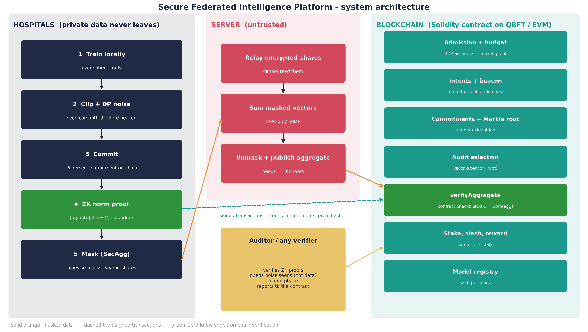
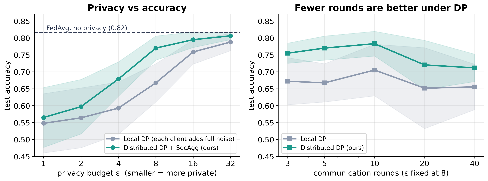
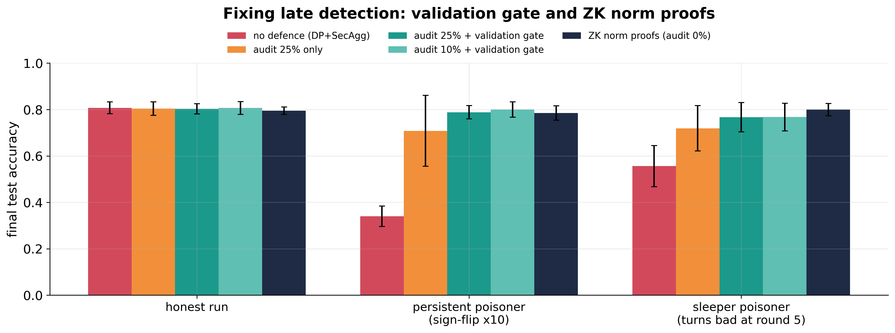
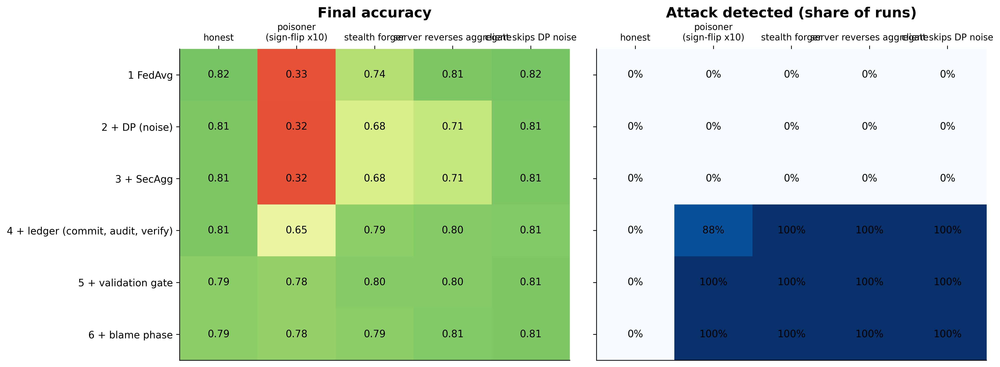
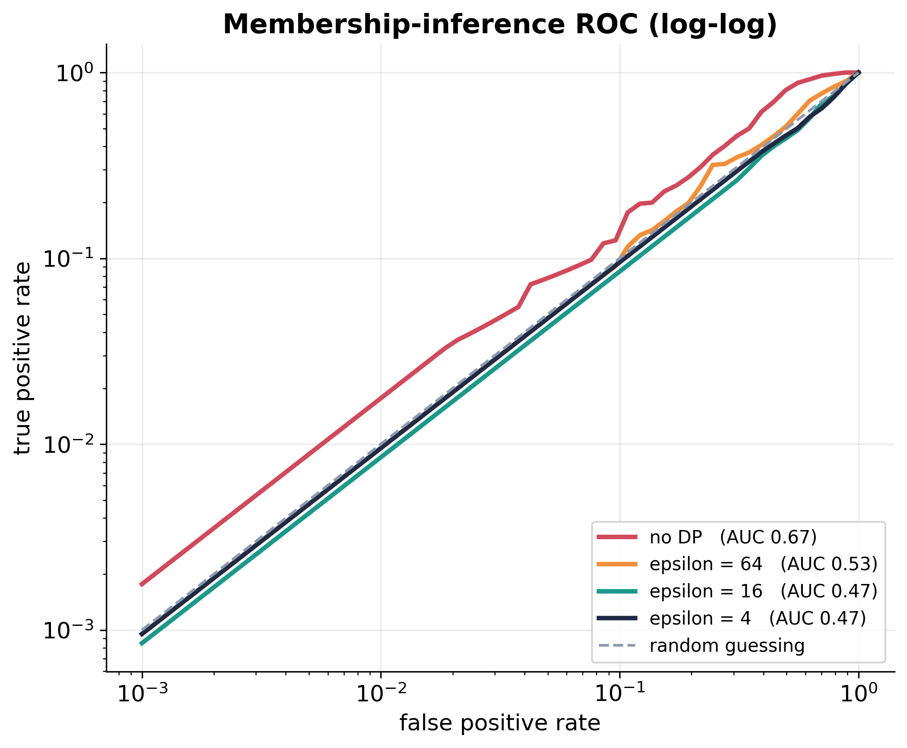

# FedVerse AI: A Secure Federated Intelligence Platform

**Federated learning across hospitals with secure aggregation, distributed differential privacy, zero-knowledge proofs and a verifiable blockchain ledger.**

Several hospitals train one heart-disease model together without sharing a single patient record. The server never sees any hospital's update, the model does not leak who was in the training data, a smart contract enforces every hospital's privacy budget, and anyone (including the contract itself) can check that the published result is exactly the sum of what the hospitals committed to. Cheaters (poisoners, hospitals that skip their noise, a server that tampers) are detected and banned.

Everything here runs on a laptop, with no GPU and no cloud account. The project is the *Phase 2* capstone of Team 23UG047, Amrita School of Computing, Bengaluru (see [Credits](#credits)).

> **Short version:** `pip install -r requirements.txt`, then `python demo_attacks.py` shows 13 attacks being stopped; `python -m streamlit run app.py` opens a dashboard; `python -m pytest tests -q` runs 66 tests. The table in the next section tells you what every command produces.

---

## Table of contents

1. [What to run to get what](#what-to-run-to-get-what)
2. [What the system does](#what-the-system-does)
3. [Headline results](#headline-results)
4. [Installation](#installation)
5. [Guided tours](#guided-tours): tests, attack demo, dashboard, experiments, real blockchain, BFT network, distributed run, report pack
6. [Repository layout](#repository-layout)
7. [The smart contract](#the-smart-contract)
8. [Using it as a library](#using-it-as-a-library-the-config-object)
9. [Security model](#security-model-and-honest-limitations)
10. [Reproducibility and troubleshooting](#reproducibility-notes)
11. [Credits](#credits)

---

## What to run to get what

All commands are run from the repository root. "Needs" lists anything beyond `pip install -r requirements.txt`.

| I want to... | Run | Needs | You get | Time* |
|---|---|---|---|---|
| **Check everything works** | `python -m pytest tests -q` | Node for the chain tests (they skip themselves otherwise); Java + Besu for the consensus test | `66 passed`: every security property is asserted | ~4 min |
| **Check only the pure-Python part** | `python -m pytest tests/test_crypto.py tests/test_system.py tests/test_zk.py -q` | nothing | 46 tests: cryptography, federation, attacks, ZK proofs | ~1 min |
| **See the attacks being stopped** | `python demo_attacks.py` | nothing | A printed table of 13 attacks, "undefended" vs "defended", plus `results/demo_attacks.md` | ~3 min |
| **...against the real contract** | `python demo_attacks.py evm` | Node (see [install](#installation)) | The same 13 attacks against the Solidity contract on a local chain; writes `results/demo_attacks_evm.md` | ~3 min |
| **Click around a dashboard** | `python -m streamlit run app.py` | nothing (Node for the real-chain options) | A browser app: choose attacks and defences, see accuracy, privacy budgets, ledger blocks, a tamper test | interactive |
| **Reproduce one result** | `python -m experiments.run_experiments privacy_utility` | nothing | `results/privacy_utility.csv` and a printed summary table | 3 min |
| **Reproduce all pure-Python results** | see [Experiments](#4-reproduce-the-research-results) | nothing | all `results/*.csv` except the chain ones | ~45 min |
| **Redraw the paper figures** | `python make_figures.py` | nothing (CSVs are in the repo) | `results/figures/fig*.png` | 20 s |
| **Rebuild the whole report pack** | `python -m report.build_report` | `pip` extras in `requirements.txt` | `report_assets/`: 24 figures (PNG + PDF), 22 tables (CSV, Markdown, LaTeX, Excel), a Word results chapter | ~1 min |
| **Run on a real blockchain** | `python -m streamlit run app.py`, pick the "real blockchain" backend | Node 18+ and `cd chain && npm install` | Every action becomes a signed transaction; real gas is measured | 20 s per run |
| **Run on a 4-validator BFT network** | `python -m fedsec.besunet start` (or just use backend `besu`, which starts it) | Java 17+ and the Besu download | A real QBFT network; kill validators to see fault tolerance | ~1 min to start |
| **Run as separate processes** | `python -m fedsec.dist.launch --clients 5 --rounds 4 --drop 2:1` | Node | 1 server + 5 hospital processes; hospital 2 crashes in round 1; `results/distributed/result.json` | ~1 min |
| **Read the threat model** | open [`docs/SECURITY.md`](docs/SECURITY.md) | | Assumptions, 10 guarantees with proof sketches, what is *not* claimed | |

\*On an 8-thread laptop, CPU only.

---

## What the system does



Each training round, with hospitals on the left, an **untrusted** server in the middle and the contract on the right:

1. **Admission.** The contract recomputes each hospital's privacy spending ε from the noise it declared and *refuses* hospitals that are banned, unstaked or over budget.
2. **Local training.** Every hospital trains on its own patients and clips its update to norm *C*.
3. **Verifiable noise.** Each hospital commits to a secret *noise seed* **before** a public random *beacon* exists; its DP noise is generated from seed + beacon. An auditor can later regenerate the noise exactly, so skipping noise is detectable.
4. **Commit.** Each hospital posts a Pedersen commitment to its (noised) update; the contract stores the Merkle root.
5. **Zero-knowledge norm proof (optional).** Each hospital proves, without revealing the update, that its norm is within the clip bound. Anyone can verify; no trusted auditor.
6. **Secure aggregation.** Updates are masked (pairwise X25519 masks + Shamir-shared keys); the server only learns the **sum**. Hospitals that crash mid-round are recovered from their shares.
7. **Verification.** The product of the commitments must equal the commitment to the published aggregate. The **contract does this check itself** (1024-bit modular arithmetic built from the EVM `modexp` precompile). The server's list of survivors must equal the set of hospitals that signed "submitted".
8. **Gates and audits.** Audits are chosen by `keccak(beacon, Merkle root)` so nobody controls them; a validation gate rolls back rounds that make the model worse; a blame phase identifies a forger or a cheating server; failed audits slash the hospital's stake.
9. **Record.** Model hash, budgets and audit results are on-chain. Honest hospitals share the slashed stake.

Three ways to run the *same* protocol:

| Backend | `Config(chain=...)` | What it is | Use it for |
|---|---|---|---|
| Simulated ledger | `"sim"` | the contract's rules in plain Python | fast experiments (hundreds of runs) |
| Real contract, one node | `"evm"` | Solidity on a local Hardhat chain, signed transactions from separate accounts, **measured** gas | the demo, gas numbers |
| Real BFT network | `"besu"` | the same contract on **4 Hyperledger Besu validators (QBFT)** | consensus and fault-tolerance demos |

Plus a **distributed** mode (`fedsec/dist`) where the server and every hospital are separate OS processes talking over HTTP, each with its own keys and chain account.

---

## Headline results

All numbers are means over 5-20 random seeds on four real hospital datasets (UCI Heart Disease: Cleveland, Hungarian, Switzerland, VA; 920 patients). Full tables are in `report_assets/tables/` and the raw runs in `results/`.

| Question | Result |
|---|---|
| **What does privacy cost?** (5 rounds, ε = 8) | **0.77** accuracy with our distributed DP, vs 0.67 for local DP, vs 0.82 with no privacy (a centralised model also gets 0.82) |
| **Does the model leak who was in the training data?** | Membership-inference AUC **0.66 without DP → chance (≈0.5) at ε ≤ 16** |
| **What does the server see?** | Similarity to the true update: **1.00 without** secure aggregation, **0.00 with** it. The learned model is identical either way. |
| **Poisoning** (one attacker, sign-flip ×10) | **0.34 undefended → 0.79** with the validation gate or the ZK norm proof (both 100% detection, no false alarms). Random audits alone: 0.71 ± 0.15 (depends on audit luck). |
| **Is the aggregate verified?** | The **contract itself** rejects forged / swapped aggregates, even if a lying server claims "verified". |
| **Budget accounting on-chain** | On-chain ε = 8.006 vs analytic 8.000 (always rounded up) |
| **Fault tolerance** | 1 of 4 validators killed: federation still completes. 2 killed: chain halts safely (no fork). A hospital crash mid-round is recovered and charged correctly. |
| **Cost** (real chain, 4-8 hospitals) | 23-42 transactions and 4-7 M gas per round; ~1 s/round on one node, 14-19 s/round on QBFT (1 s blocks) |

<p align="center">
  
  
</p>
<p align="center">
  
  
</p>

**Honest negatives (these are results too):**

* Robust aggregators (Krum, Multi-Krum, median, trimmed mean) **match or beat our accuracy under attack** (0.81-0.82 vs 0.79), but they must see every individual update, so they cannot run under secure aggregation. Our claim is comparable robustness *while the server learns nothing*, not better robustness.
* On a second, larger dataset (Forest Covertype, MLP with 1,665 parameters, 4 hospitals) client-level DP is expensive (0.78 → 0.58 at ε = 8) and distributed DP shows **no advantage** there.
* The ZK norm proof's cost is linear in model size: 0.3 s at 14 parameters, 2.9 s at 256, ~19 s extrapolated at 1,665. Practical for small models only.
* Label-flipping that stays inside the norm bound is **bounded, not detected**.

---

## Installation

You need **Python 3.10+** (developed on 3.14). Node and Java are only needed for the blockchain features, so you can run everything else without them.

### 1. Python part (required)

```bash
git clone https://github.com/Rithvik-Ambati/fedverseai---project-phase-2.git
cd fedverseai---project-phase-2
python -m venv .venv
# Windows:  .venv\Scripts\activate        macOS/Linux:  source .venv/bin/activate
pip install -r requirements.txt
python -m pytest tests/test_crypto.py -q          # quick sanity check, ~5 s
```

> **Tip:** always start tools as `python -m pytest ...` / `python -m streamlit ...`. If several Python versions are installed, a bare `streamlit` or `pytest` may use a different interpreter that lacks the packages.

### 2. Real blockchain (optional, for `chain="evm"`)

Needs **Node.js 18+**.

```bash
cd chain
npm install              # installs Hardhat (about 270 MB)
npx hardhat compile      # compiles the Solidity contract (downloads the 0.8.24 compiler once)
cd ..
```

You do **not** have to start a node by hand: the code starts `npx hardhat node` automatically on first use and stops it on exit.

### 3. Real BFT network (optional, for `chain="besu"`)

Needs **Java 17+** (tested with Java 26) and a Besu release:

1. Download `besu-<version>.zip` from <https://github.com/hyperledger/besu/releases> (tested with **26.10.1**, ~184 MB).
2. Unzip it into `chain/besu-dist/` so that `chain/besu-dist/besu-<version>/bin/besu` (or `besu.bat` on Windows) exists.
3. Done. The four validator keys and the genesis file are generated automatically on first start into `chain/qbft/` (this folder is git-ignored).

### 4. Docker (optional, untested)

`deploy/Dockerfile` and `deploy/docker-compose.yml` describe the distributed run in containers. **We could not test them** (the Docker daemon was not running on the development machine), so treat them as a starting point.

---

## Guided tours

### 1. Run the tests

```bash
python -m pytest tests -q
```

| File | Tests | What it proves | Needs |
|---|---|---|---|
| `test_crypto.py` | 7 | valid group; Pedersen homomorphic + binding; Shamir; **secure aggregation exact with dropouts**; Merkle; RDP accountant | Python |
| `test_system.py` | 28 | every attack and defence end-to-end (forgery, swapped aggregate, dropped hospital, skipped noise, budget, gate, ZK mode, blame, robust baselines, 2nd dataset...) | Python |
| `test_zk.py` | 7 | ZK proof verifies; oversized / tampered / replayed proofs are rejected | Python |
| `test_chain.py` | 13 | the same properties on the **real contract**: role separation, contract rejects strangers, on-chain ε, stake/slash/withdraw | Node |
| `test_onchain_verify.py` | 5 | 1024-bit modular multiplication vs Python; the contract overrules a lying server | Node |
| `test_distributed.py` | 1 | server + 4 hospital processes, one **really crashes**, every aggregate still verified by the contract | Node |
| `test_besu.py` | 1 | 4 validators; kill 1 → still works; kill 2 → chain halts | Java + Besu |

Tests that need a missing tool skip themselves.

### 2. Watch 13 attacks get stopped

```bash
python demo_attacks.py          # simulated ledger, fast
python demo_attacks.py evm      # same attacks against the real Solidity contract
```

Each attack runs twice, **undefended** (DP + secure aggregation only) and **defended** (the full system), and prints a verdict, for example:

```
[2] Model poisoning (sign-flip, 10x boost)
    undefended: acc 0.29  (clean 0.82)
    defended  : acc 0.80; client 3 banned=True, first caught round 0
    => DETECTED + EXCLUDED
```

The attacks: a server reading updates · poisoning · stealth poisoning (forged input) · a server reversing the aggregate · a server dropping a hospital · skipped DP noise · under-declared noise to dodge the budget · rewriting the ledger · swapping a stored model · label flipping (**the one that is not detected**, by design) · a poisoner with audits switched off (ZK proof catches it) · a sleeper poisoner · a forger that stalls every round (blame phase identifies it).

### 3. The dashboard

```bash
python -m streamlit run app.py          # opens http://localhost:8501
```

A good 5-minute walk-through (every step takes a few seconds):

| Step | Settings (rest at default) | What you should see |
|---|---|---|
| 1. Baseline | click **Run** | accuracy ≈ 0.80, max ε = 8.00, 0 rejected rounds, server-view similarity ≈ 0 |
| 2. No secure aggregation | untick *secure aggregation* | similarity jumps to **1.000**, accuracy unchanged |
| 3. Poison, no defence | malicious client 3 = `scale`; untick *ledger* | accuracy collapses to ≈ 0.29 |
| 4. Same attack, defended | tick *ledger*, audit rate 0.5 | accuracy ≈ 0.81; "banned by reputation: [3]" |
| 5. Malicious server | malicious server = `swap_aggregate` | 4 rejected rounds, `aggregate_verification_failed` events, training recovers |
| 6. Budget | per-client ε budget = 5 | ε stops at ≈ 4.7; "refused" events |
| 7. Ledger tab | after any run | hash-chain check, blocks/transactions, gas, a **tamper button** that turns the check red |

*Advanced defences* (expander): ZK norm proofs, validation gate, on-chain verification, blame phase, stake. The backend selector switches between the simulated ledger, the real chain and the 4-validator network (with buttons to stop validators).

### 4. Reproduce the research results

Experiments live in `experiments/run_experiments.py`. Each writes a CSV into `results/` and prints a summary. Add `--quick` for a smoke test.

```bash
python -m experiments.run_experiments <name> [--quick]
```

| `<name>` | Question it answers | Output | Needs |
|---|---|---|---|
| `privacy_utility` | accuracy vs ε, local vs distributed DP, effect of #rounds | `privacy_utility.csv` | - |
| `membership` | does DP stop membership inference (canary records)? | `membership.csv` | - |
| `attacks` | attack × defence matrix (20 seeds) | `attacks.csv` | - |
| `audit_tradeoff` | audit rate vs detection vs exposure; seeded vs statistical audit | `audit_tradeoff.csv` | - |
| `adaptive` | persistent vs sleeper poisoner; gate vs ZK proofs | `adaptive_audit.csv` | - |
| `baselines` | vs Krum / median / trimmed mean | `baselines.csv` | - |
| `covtype` | second dataset (Forest Covertype, MLP) | `covtype.csv` | internet once (auto-download ~11 MB) |
| `overhead` | cost of each layer vs #hospitals | `overhead.csv` | - |
| `dropout` | dropout tolerance and the real ε charged | `dropout.csv` | - |
| `zk_cost` | ZK proof time/size vs model size | `zk_cost.csv` | - |
| `chain_overhead` | measured gas/latency vs #hospitals on the real chain | `chain_overhead.csv` | Node |
| `chain_backends` | Hardhat vs 4-validator QBFT, on-chain verification | `chain_backends.csv` | Node + Besu |
| `distributed` | server + hospital processes, with a crash | `distributed.csv` | Node |

Run all the pure-Python ones (about 45 minutes on 8 cores):

```bash
for e in privacy_utility membership attacks audit_tradeoff adaptive baselines covtype overhead dropout zk_cost; do
  python -m experiments.run_experiments $e
done
```

(`all` also runs the three chain experiments, so it needs Node and Besu.) Experiments run in a process pool, so close other heavy programs while they run. The committed CSVs in `results/` are the ones behind every number in this README.

### 5. Real blockchain on one node

```bash
cd chain && npm install && cd ..
python demo_attacks.py evm
python -m experiments.run_experiments chain_overhead      # measured gas vs #hospitals
```

or tick the *real blockchain* backend in the dashboard. In Python: `Config(chain="evm")`. Every hospital, the server, the auditor and the owner is a separate account and every action is a signed transaction; the contract rejects calls from the wrong role (tested).

### 6. The 4-validator BFT network

```bash
python -m fedsec.besunet start      # generates keys + genesis on first run, starts 4 Besu validators (keeps running; Ctrl+C stops them)
python -m fedsec.besunet status     # in another terminal: block height and peer count per validator
```

then `Config(chain="besu")`, or the dashboard backend selector, where you can also **stop validators** from the Ledger tab. `python -m pytest tests/test_besu.py` automates the experiment: with 3 of 4 validators the system keeps working, with 2 of 4 the chain stops producing blocks (safety over liveness) and never forks.

### 7. Separate processes (distributed run)

```bash
python -m fedsec.dist.launch --clients 5 --rounds 4                 # normal run
python -m fedsec.dist.launch --clients 5 --rounds 4 --drop 2:1      # hospital 2 crashes in round 1
```

This deploys the contract, registers the hospitals, then starts **one server process and one process per hospital**. Hospitals load only their own silo, generate their own keys, send each other end-to-end-encrypted secret shares through the untrusted server, and post their own transactions. Logs and results go to `results/distributed/` (`server.log`, `client*.log`, `result.json`). In the crash run you will see round 1 complete with 4 survivors and 1 dropped hospital, the masks rebuilt from Shamir shares, and the contract still verifying the aggregate.

### 8. The report pack (figures and tables for a paper or slides)

```bash
python -m report.build_report            # ~1 min; uses the committed results/ and report_assets/data/
python -m report.extra_experiments       # optional (~6 min): regenerates convergence, ROC, ablation, per-hospital data
```

Creates, in `report_assets/`:

* `figures/` 24 figures as 300-dpi PNG **and** vector PDF (architecture, ZK-proof flow, ROC curves, ablation, baselines, chain costs, ...)
* `tables/` 22 tables as CSV, Markdown, LaTeX and one `all_tables.xlsx`
* `Results_and_Evaluation.docx` an editable results chapter with captions
* `INDEX.md` every figure/table with a caption and `HEADLINES.md` the numbers to quote and their caveats

---

## Repository layout

```
.
├── fedsec/                      the system (Python package)
│   ├── federation.py            the round loop, DP noise, commitments, audits, gates, attack hooks
│   ├── secagg.py                secure aggregation: masks, Shamir shares, dropout recovery, encrypted share relay
│   ├── pedersen.py  gen_group.py    homomorphic commitments in a 1024-bit Schnorr group
│   ├── zkproofs.py              zero-knowledge proof that an update's L2 norm is bounded
│   ├── accountant.py            Renyi-DP accountant (reference implementation)
│   ├── ledger.py                simulated ledger / contract (same rules in Python)
│   ├── evmchain.py              web3.py bridge to the real contract (+ batching)
│   ├── besunet.py               4-validator QBFT network manager
│   ├── robust.py                Krum, Multi-Krum, median, trimmed mean (baselines)
│   ├── attacks.py               membership-inference and canary attacks
│   ├── data.py  model.py        hospital datasets (+ Covertype), models, local training
│   └── dist/                    server and hospital as separate processes (HTTP + chain)
├── chain/
│   ├── contracts/PrivacyLedger.sol   the smart contract
│   ├── contracts/Big.sol             1024-bit modular arithmetic on the modexp precompile
│   └── hardhat.config.js  package.json
├── experiments/run_experiments.py    all research experiments -> results/*.csv
├── report/                      builds the report pack (figures, tables, Word chapter)
├── report_assets/               the generated report pack (figures/, tables/, data/)
├── results/                     raw experiment outputs (CSV), figures, attack-demo tables
├── tests/                       66 automated tests
├── docs/SECURITY.md             threat model, assumptions, guarantees, proof sketches
├── data/                        the four UCI hospital files (+ a small Covertype sample)
├── deploy/                      Dockerfile + compose (untested)
├── app.py                       Streamlit dashboard
├── demo_attacks.py              the 13-attack demonstration
└── make_figures.py              redraws results/figures from the CSVs
```

---

## The smart contract

`chain/contracts/PrivacyLedger.sol` (~520 lines, Solidity 0.8.24). Roles: **owner** (registers hospitals), **server**, **auditor**, and **one account per hospital**.

| Function | Caller | Purpose |
|---|---|---|
| `register` | owner | add a hospital with its privacy budget ε<sub>max</sub> |
| `beginRound` | server | open a round; admit or refuse each hospital (ban, stake, **on-chain ε check**) |
| `postIntent`, `revealNonce`, `closeReveals` | hospital / anyone | declare noise, commit to the noise seed, derive the public beacon |
| `postCommitment`, `postProof`, `closeCommitments` | hospital / anyone | commit to the update (+ ZK proof hash); Merkle root |
| `selectAudits`, `reportAudit` | anyone / auditor | unpredictable audit selection; reputation, ban, slash |
| `markSubmitted` | hospital | signed "I sent my masked vector" (with its hash) |
| `verifyAggregate` | server | **the contract checks ∏ C<sub>u</sub> = Com(aggregate) itself** |
| `postAggregate` | server | record the result; survivors must equal the submitted set; charge budgets |
| `deposit`, `slashServer`, `distributeRewards`, `withdraw` | various | stake, server bond, slashing, shared rewards |

The privacy accountant runs **inside the contract** in fixed-point arithmetic. Gaussian RDP is linear in the order α, so the contract stores one number per hospital and recomputes ε = min<sub>α</sub>(α·A + c<sub>α</sub>) over 32 orders, with the logarithm constants pre-computed. On-chain ε matches the analytic accountant to 0.1%.

---

## Using it as a library: the `Config` object

Every layer can be switched on or off independently, which is how the ablations were produced.

```python
from fedsec.federation import Config, Federation
from fedsec.accountant import noise_for_eps

cfg = Config(
    n_clients=8, rounds=10,
    dp="distributed", z=noise_for_eps(8, 10),     # total epsilon 8 over 10 rounds
    secagg=True, ledger=True, chain="sim",        # "sim" | "evm" | "besu"
    audit_rate=0.25, val_gate=True,               # audits + validation gate
    malicious={3: "scale"}, attack_scale=10,      # hospital 3 poisons (sign-flip x10)
)
res = Federation(cfg).run()
print(res["final"]["acc"], res["banned"], res["eps"])
```

| Field | Values | Meaning |
|---|---|---|
| `dp`, `z` | `none` / `local` / `distributed`, noise multiplier | where the DP noise is added and how much |
| `secagg` | bool | secure aggregation on/off |
| `ledger`, `chain` | bool; `sim` / `evm` / `besu` | commitments + contract; which backend |
| `audit_rate`, `audit_mode` | 0-1; `seeded` / `statistical` | random audits; how noise is checked |
| `norm_proof` | `none` / `zk` | zero-knowledge norm proof from every hospital |
| `val_gate` | bool | validation gate (rollback + emergency audit) |
| `onchain_verify` | bool | the contract itself checks the aggregate (real chains) |
| `attribution` | bool | blame phase after a failed check |
| `stake`, `slash` | ETH | stake / slash incentives (real chains) |
| `aggregator` | `mean` / `median` / `trimmed` / `krum` / `multikrum` | robust baselines (need `secagg=False`) |
| `dataset` | `heart` / `covtype` | which data |
| `dropout`, `eps_max` | 0-1; ε cap | client dropout; per-hospital privacy budget |
| `malicious`, `attack_scale`, `attack_rounds` | `{cid: scale\|labelflip\|noeps\|overbudget\|forge}` | malicious hospitals |
| `server_attack` | `swap_aggregate` / `drop_client` | malicious server |

---

## Security model and honest limitations

The full statement is in **[docs/SECURITY.md](docs/SECURITY.md)**: parties, assumptions, ten guarantees (G1-G10) each with a mechanism, a proof sketch and the tests that check it. In short:

| Guarantee | Mechanism |
|---|---|
| The server sees only the sum | secure aggregation (X25519 masks + Shamir shares, dropout recovery) |
| The released model is differentially private | clip + shared Gaussian noise + RDP accountant (also in the contract) |
| The aggregate is the true sum | Pedersen homomorphism, checked by the contract |
| The server cannot drop a hospital | hospitals' signed `markSubmitted` set |
| Budgets cannot be bypassed | on-chain accountant at admission |
| A poisoner cannot exceed the norm bound | ZK norm proof every round |
| Noise cannot be skipped | seed committed before the beacon; seeded audit |
| History cannot be rewritten | hash-linked blocks / QBFT |

**What is *not* done or *not* claimed**

* **TEE-based audit: not implemented.** It needs secure-enclave hardware (SGX / SEV / Nitro); a software "enclave" would add no security.
* **Shapley-style rewards: not implemented.** They need individual updates, which secure aggregation deliberately hides; stake / slash / reward is used instead.
* Noise correctness is *audited*, not *proven* (a ZK proof of Gaussian sampling is open). The ZK norm proof covers the clean update's bound only.
* Updates that stay **inside** the norm bound (e.g. label flipping) are bounded, not detected.
* Secure aggregation is **passive-secure against the server** (no extra consistency round).
* The BFT network and the distributed processes run on **one machine**; Docker files are untested.
* **Demo-sized cryptography** (1024-bit group). The simulation uses seeded blinding factors for repeatability. A real deployment needs larger groups and fresh randomness.
* Results are on a small dataset (920 patients), so error bars are real; always read the ± values.

---

## Reproducibility notes

* **Determinism.** In simulation, the same `Config` and `seed` give identical results (blinding factors are seeded). With secure aggregation switched on vs off, the learned model is bit-for-bit identical, as the theory says. On the real chains, the beacon is derived from `keccak`, so noise differs slightly from the simulation; compare means, not single runs.
* **Seeds.** Experiments use 5-20 seeds and report mean ± s.d.; the seed count is in each table caption.
* **Data.** The four heart-disease files are in `data/` (public UCI data). Forest Covertype downloads on first use via scikit-learn and a 20,000-row sample is cached in `data/covtype_sample.npz`.
* **Hyper-parameters** (logistic regression, 5-10 rounds, clip 0.5, 15 local epochs) were tuned on different seeds from those reported, but the underlying patients overlap.
* **Timing** figures are from one 8-thread Windows laptop; expect different absolute values elsewhere.

### Troubleshooting

| Symptom | Fix |
|---|---|
| `ModuleNotFoundError: torch` (or web3) when running Streamlit | use `python -m streamlit run app.py` so the same interpreter is used |
| Chain tests are skipped | install Node 18+ and run `cd chain && npm install` |
| `Besu not found in chain/besu-dist` | download and unzip Besu there (see [Installation](#3-real-bft-network-optional-for-chainbesu)) |
| Besu does not start on Windows | check `chain/qbft/node0.log`; Java 17+ is required; kill stray `java.exe` processes and retry |
| Port 8545 / 8550 / 9100 already in use | stop the other process, or set `FEDSEC_RPC=http://127.0.0.1:<port>` for the Hardhat node; `--port` for the distributed run |
| First chain run is slow | it starts the node and compiles the contract once; later runs take ~20 s |
| Covertype experiment fails offline | it needs internet once to download the dataset |
| Numbers differ in the second decimal | expected across machines and seeds; compare means ± s.d. |

---

## Credits

**Project Phase 2, CSE498, Amrita School of Computing, Amrita Vishwa Vidyapeetham, Bengaluru.**

* Team 23UG047: Kangati Shashidhar Reddy (BL.EN.U4CSE23129), Sai Rithvik Ambati (BL.EN.U4CSE23151), Taduri Abhichakra (BL.EN.U4CSE23157)
* Guide: Dr. Meena Belwal, Assistant Professor (Sl. Gd.)

Built on public datasets and open tools: the UCI Heart Disease and Forest Covertype datasets, PyTorch, scikit-learn, `cryptography`, web3.py, Hardhat, Solidity and Hyperledger Besu. The protocols implement or adapt ideas from the secure-aggregation work of Bonawitz et al., DP-SGD and Rényi DP (Abadi et al.; Mironov; Balle et al.), distributed DP (Kairouz et al.), Pedersen commitments, RoFL / PINE (norm-bound verification), Krum (Blanchard et al.) and blockchain-based FL surveys; the report cites the full list.

*Licence:* no open-source licence has been chosen yet; until a `LICENSE` file is added, all rights remain with the authors.
